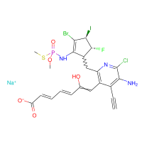
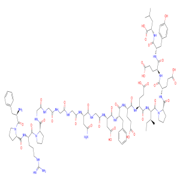
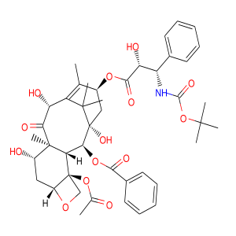
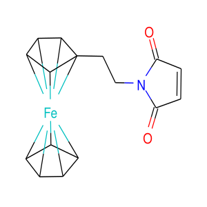
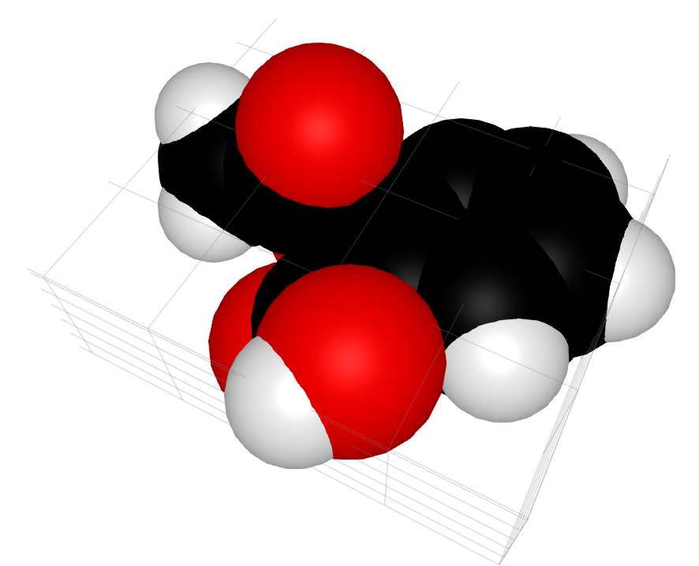
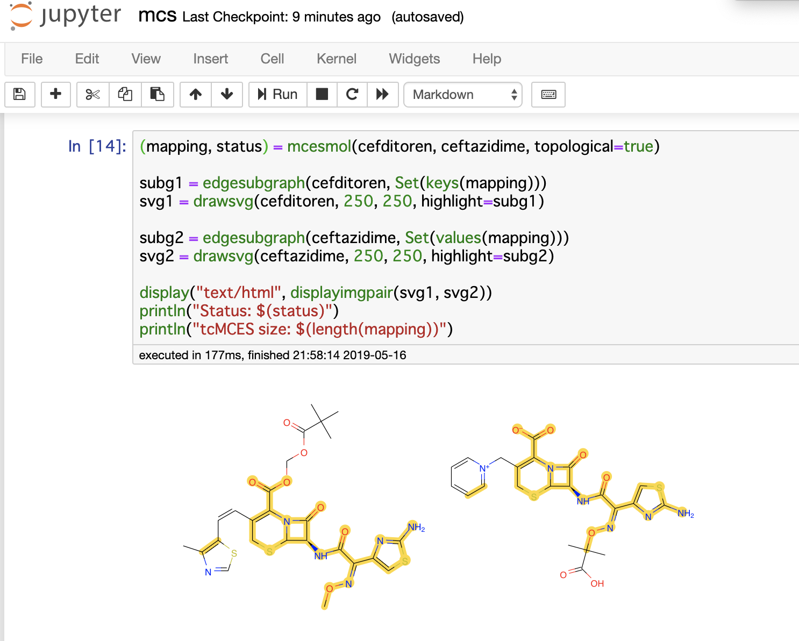
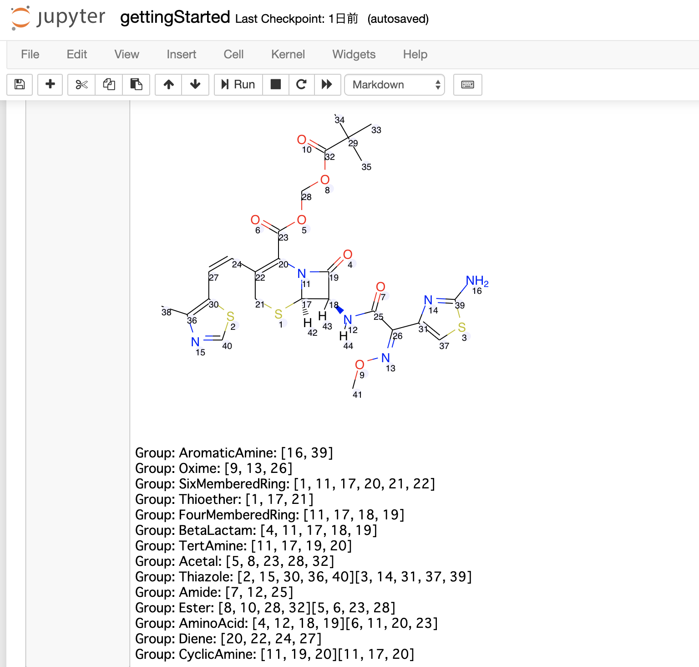
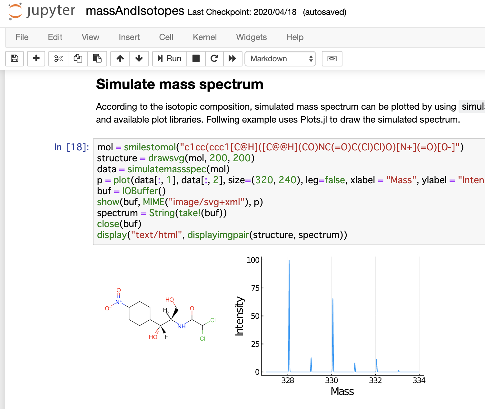

MolecularGraph.jl
===================================================

[](https://zenodo.org/badge/latestdoi/151080560)

[](https://mojaie.github.io/MolecularGraph.jl/dev)


**MolecularGraph.jl** is a graph-based molecule modeling and chemoinformatics analysis toolkit fully implemented in Julia.






https://github.com/user-attachments/assets/9844a6f7-d172-4278-82b8-d4f307dff13f


Installation
------------------------------------

MolecularGraph.jl requires Julia 1.10.12 or later.

```
pkg> add MolecularGraph
```

Some features are provided as package extensions and are enabled by loading the corresponding
packages.

- [Cairo.jl](https://github.com/JuliaGraphics/Cairo.jl): PNG export of 2D structure images (`drawpng`)
- [Makie.jl](https://github.com/MakieOrg/Makie.jl): 3D molecule rendering (`spacefilling`, `ballstick`, `stick`, `wire`)
- [RDKitMinimalLib.jl](https://github.com/eloyfelix/RDKitMinimalLib.jl): SMILES writer and fingerprints (not available on Windows currently)


Quick start
------------------------------------

```julia
using MolecularGraph

mol = smilestomol("CC(=O)Oc1ccccc1C(=O)O")  # aspirin
molecular_formula(mol)  # "C9H8O4"
standard_weight(mol, 2)  # 180.16
wclogp(mol, 2)  # 1.31
has_substruct_match(mol, smartstomol("c[CX3](=O)[OX2H1]"))  # true
inchikey(mol)  # "BSYNRYMUTXBXSQ-UHFFFAOYSA-N"
svg = drawsvg(mol)  # 2D structure image as an SVG string

mol2 = sdftomol("path/to/file.mol")  # read a molfile
for m in sdfilereader("path/to/file.sdf")  # iterate over molecules in an SDFile
    println(molecular_formula(m))
end
```


Documentation
------------------------------------

[Documentation and API reference](https://mojaie.github.io/MolecularGraph.jl/dev)

- Getting started and basics: molecular graph models, properties and descriptors, drawing,
  preprocessing, stereochemistry, mass and isotopes, substructure and query, MCS
- Advanced topics: interfaces of molecular graph models, customizing atom and bond properties
- API reference: docstrings of all exported functions and types


Features
------------------

- Chemical structure file I/O
  - SDFile reader/writer (.sdf, .mol)
  - SMILES/SMARTS reader
  - ChemDraw CDXML reader
  - JSON serialization (lossless format and CommonChem JSON)
  - SMILES writer ([RDKitMinimalLib.jl](https://github.com/eloyfelix/RDKitMinimalLib.jl))
  - InChI and InChIKey ([InChI](https://www.inchi-trust.org/))

- Drawing
  - 2D structure images in SVG and PNG ([Cairo.jl](https://github.com/JuliaGraphics/Cairo.jl))
  - 2D coordinates generation ([coordgenlibs](https://github.com/schrodinger/coordgenlibs))
  - 3D molecule rendering ([Makie.jl](https://github.com/MakieOrg/Makie.jl))

- Properties and descriptors
  - Valence, hydrogens, hybridization, aromaticity
  - H-bond donor/acceptor, rotatable bonds (descriptors of Lipinski's rule of five)
  - Wildman-Crippen logP
  - Fingerprints ([RDKitMinimalLib.jl](https://github.com/eloyfelix/RDKitMinimalLib.jl))
  - Automatic recalculation of properties when the molecule is modified

- Stereochemistry
  - Stereocenters and cis-trans stereobonds from SMILES and SDFile (2D wedges)
  - Stereochemistry preserved through hydrogen removal and other graph modifications
  - 2D wedges kept consistent with the stereochemistry for drawing, SDFile output and InChI

- Preprocessing
  - Hydrogen removal/addition, largest component extraction
  - Charge standardization (protonation/deprotonation), kekulization

- Atomic mass
  - Standard atomic/molecular weight, monoisotopic and exact mass with uncertainty
  - Isotopic composition and simulated mass spectrum

- Substructure and query
  - Subgraph isomorphism detection with VF2 algorithm
    - SMARTS query match (including recursive SMARTS)
    - Monomorphism, node-induced and edge-induced match
    - Constraints (mandatory/forbidden vertex mapping)
  - Functional group query set
  - Structural alerts detection with ChEMBL dataset
  - SMARTS query containment

- Molecular graph topology
  - Ring, scaffold, connected components
  - Minimum cycle basis (de Pina algorithm)
    - Smallest set of smallest rings (SSSR)
  - Planarity (left-right planarity test)
  - Maximum matching
    - Kekulization
  - Graph traversal

- Maximum common substructure (MCS)
  - By clique detection algorithm
  - Node-induced (MCIS) and edge-induced (MCES)
  - Connected and disconnected
  - Topological constraint (known as tdMCS)
  - Diameter restriction (MCS-DR) and graph-based local similarity (GLS)

- Shared library for other languages (experimental)
  - C shared library with JSON input/output built by
    [JuliaC.jl](https://github.com/JuliaLang/JuliaC.jl) (`juliac --trim=safe`).
    See [build/README.md](./build/README.md).

AI Assistance
-----------------

Generative AI tools are used to assist with code development, bug fixing, documentation writing, and pull request reviews. All AI-generated contributions are reviewed and validated by the human maintainer, who retains full responsibility for the package's design, implementation, and maintenance.

License
-----------------

[MIT license](http://opensource.org/licenses/MIT)  
See [Assets/README.md](https://github.com/mojaie/MolecularGraph.jl/tree/master/assets) for details of external data sets and their licenses.


Copyright
-----------------

(C) 2018-2026 Seiji Matsuoka and contributors
